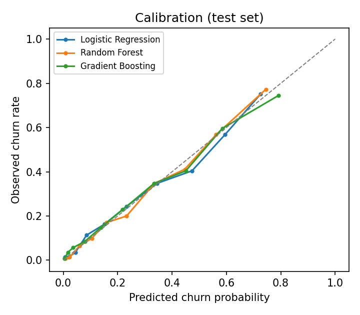
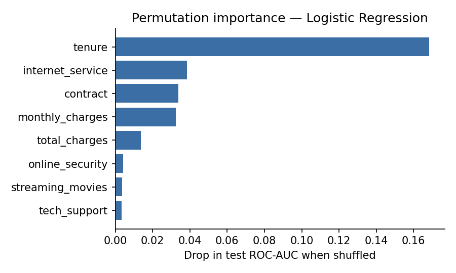

# Customer Churn Prediction & Retention Targeting — Results

## 1. Data
- Rows: **7,043** customers, 21 columns; churn rate **26.5%**
- `TotalCharges` blank for 11 customers, all with tenure 0 → set to 0 (no bills yet)
- Duplicate customer IDs: 0

## 2. Customer analytics (SQL)
**Overall**

| customers | churned | churn_rate_pct | avg_monthly_charges |
|---|---|---|---|
| 7,043 | 1,869 | 26.54 | 64.76 |

**Churn by contract type**

| contract | customers | churn_rate_pct | monthly_revenue_lost |
|---|---|---|---|
| Month-to-month | 3,875 | 42.71 | 120,847 |
| One year | 1,473 | 11.27 | 14,118 |
| Two year | 1,695 | 2.83 | 4,165 |

**Churn by tenure cohort**

| tenure_cohort | customers | churn_rate_pct |
|---|---|---|
| 01: 0-6 months | 1,481 | 52.94 |
| 02: 7-12 months | 705 | 35.89 |
| 03: 13-24 months | 1,024 | 28.71 |
| 04: 25-48 months | 1,594 | 20.39 |
| 05: 49+ months | 2,239 | 9.51 |

**Churn by segment (contract × internet service)**

| contract | internet_service | customers | churn_rate_pct | avg_monthly_charges |
|---|---|---|---|---|
| Month-to-month | Fiber optic | 2,128 | 54.61 | 87.02 |
| Month-to-month | DSL | 1,223 | 32.22 | 50.22 |
| One year | Fiber optic | 539 | 19.29 | 98.78 |
| Month-to-month | No | 524 | 18.89 | 20.41 |
| One year | DSL | 570 | 9.3 | 61.4 |
| Two year | Fiber optic | 429 | 7.23 | 104.57 |
| One year | No | 364 | 2.47 | 20.82 |
| Two year | DSL | 628 | 1.91 | 70.46 |
| Two year | No | 638 | 0.78 | 21.78 |

**Churn by payment method**

| payment_method | customers | churn_rate_pct |
|---|---|---|
| Electronic check | 2,365 | 45.29 |
| Mailed check | 1,612 | 19.11 |
| Bank transfer (automatic) | 1,544 | 16.71 |
| Credit card (automatic) | 1,522 | 15.24 |

**Lost monthly recurring revenue (MRR) by contract**

| contract | churned_mrr | share_of_lost_mrr_pct |
|---|---|---|
| Month-to-month | 120,847 | 86.9 |
| One year | 14,118 | 10.1 |
| Two year | 4,165 | 3 |

**Data validation checks**

| duplicate_ids | null_total_charges | charges_inconsistent_gt25pct |
|---|---|---|
| 0 | 0 | 27 |

## 3. Leakage check
Single-feature ROC-AUC on the training split (a feature > 0.90 on its own would suggest leakage). `customer_id` is excluded as an identifier.

| feature | single_feature_auc |
|---|---|
| contract | 0.74 |
| tenure | 0.735 |
| online_security | 0.708 |
| tech_support | 0.705 |
| internet_service | 0.698 |
| online_backup | 0.679 |

**Result:** no features flagged. `total_charges` is ≈ tenure × monthly charges, so it is redundant rather than leaky; it is kept because it is known at scoring time.

## 4. Model comparison
Train/test split 80/20 stratified (train 5,634, test 1,409); 5-fold stratified CV on train. Churn base rate in test: 26.5% (PR-AUC of a random model ≈ base rate).

| model | cv_roc_auc (mean ± sd) | test_roc_auc [95% CI] | test_pr_auc | brier |
|---|---|---|---|---|
| Logistic Regression | 0.846 ± 0.013 | 0.842 [0.819, 0.862] | 0.634 | 0.138 |
| Random Forest | 0.847 ± 0.009 | 0.845 [0.823, 0.865] | 0.658 | 0.135 |
| Gradient Boosting | 0.846 ± 0.010 | 0.840 [0.817, 0.861] | 0.651 | 0.137 |

**Chosen model: Logistic Regression.** Rule: keep the interpretable logistic regression unless a tree model beats it by more than 0.01 test ROC-AUC (best tree: Random Forest, 0.845 vs 0.842). Stability: CV standard deviation is small, so performance is consistent across folds.

Classification report for Logistic Regression at threshold 0.5:

```
              precision    recall  f1-score   support

        stay      0.849     0.895     0.871      1035
       churn      0.657     0.559     0.604       374

    accuracy                          0.806      1409
   macro avg      0.753     0.727     0.738      1409
weighted avg      0.798     0.806     0.800      1409

```

## 5. Lift by decile (chosen model, test set)
| decile | customers | churners | avg_pred | churn_rate | lift | cum_capture |
|---|---|---|---|---|---|---|
| 1 | 141 | 106 | 72.6% | 75.2% | 2.83x | 28% |
| 2 | 141 | 80 | 59.4% | 56.7% | 2.14x | 50% |
| 3 | 141 | 57 | 47.3% | 40.4% | 1.52x | 65% |
| 4 | 141 | 49 | 34.5% | 34.8% | 1.31x | 78% |
| 5 | 141 | 34 | 23.2% | 24.1% | 0.91x | 87% |
| 6 | 140 | 23 | 15.1% | 16.4% | 0.62x | 93% |
| 7 | 141 | 16 | 8.6% | 11.3% | 0.43x | 98% |
| 8 | 141 | 5 | 4.4% | 3.5% | 0.13x | 99% |
| 9 | 141 | 2 | 2.0% | 1.4% | 0.05x | 99% |
| 10 | 141 | 2 | 0.5% | 1.4% | 0.05x | 100% |



## 6. Churn drivers
**Logistic regression, top 10 effects** (odds ratio > 1 raises churn odds; numeric features are standardised, so their odds ratio is per 1 standard deviation):

| feature | odds_ratio |
|---|---|
| tenure | 0.29 |
| contract_Two year | 0.44 |
| internet_service_DSL | 0.5 |
| monthly_charges | 0.55 |
| internet_service_Fiber optic | 1.81 |
| contract_Month-to-month | 1.7 |
| total_charges | 1.68 |
| paperless_billing_Yes | 1.45 |
| streaming_movies_No internet service | 0.71 |
| streaming_t_v_No internet service | 0.71 |



## 7. Retention targeting economics (test set)
Assumptions (illustrative, editable at the top of the script): offer = 20% off the monthly bill for 3 months, paid by every targeted customer who stays; the offer saves 30% of would-be churners; a saved customer is worth 12 months of revenue; $2 contact cost per customer.

| target_top | customers | churners_reached | value_saved_$ | offer_cost_$ | net_value_$ |
|---|---|---|---|---|---|
| 5% | 70 | 54 | 16,790 | 1,798 | 14,992 |
| 10% | 141 | 106 | 31,191 | 3,604 | 27,586 |
| 20% | 282 | 186 | 53,181 | 7,850 | 45,331 |
| 30% | 423 | 243 | 67,951 | 12,799 | 55,152 |
| 40% | 564 | 292 | 80,511 | 17,558 | 62,954 |
| 50% | 704 | 326 | 86,422 | 22,028 | 64,394 |
| 60% | 845 | 349 | 91,301 | 26,916 | 64,385 |
| 70% | 986 | 365 | 95,570 | 32,433 | 63,137 |
| 80% | 1,127 | 370 | 97,143 | 37,601 | 59,542 |
| 100% | 1,409 | 374 | 97,974 | 45,568 | 52,405 |

**Best policy: target the top 50% riskiest customers → net value $64,394** on this 1,409-customer test set, vs. $18,353 for randomly targeting 30% and $52,405 for targeting everyone.

## 8. A/B test design for the retention offer
- Population: top-30% riskiest customers; baseline churn in this group ≈ **57.4%**
- Hypothesis: the offer reduces churn. H0: churn(treatment) = churn(control); two-sided α = 0.05, power = 80%
- Minimum detectable effect: 15% relative reduction (57.4% → 48.8%)
- **Required sample size ≈ 526 customers per arm** (two-proportion z-test)
- Primary metric: 90-day churn rate; guardrail metrics: revenue per customer (discount cost), complaint rate, and churn in the untargeted population
- Randomise at customer level within the targeted group, fix the sample size and duration in advance (no peeking), and report the effect with a 95% confidence interval
